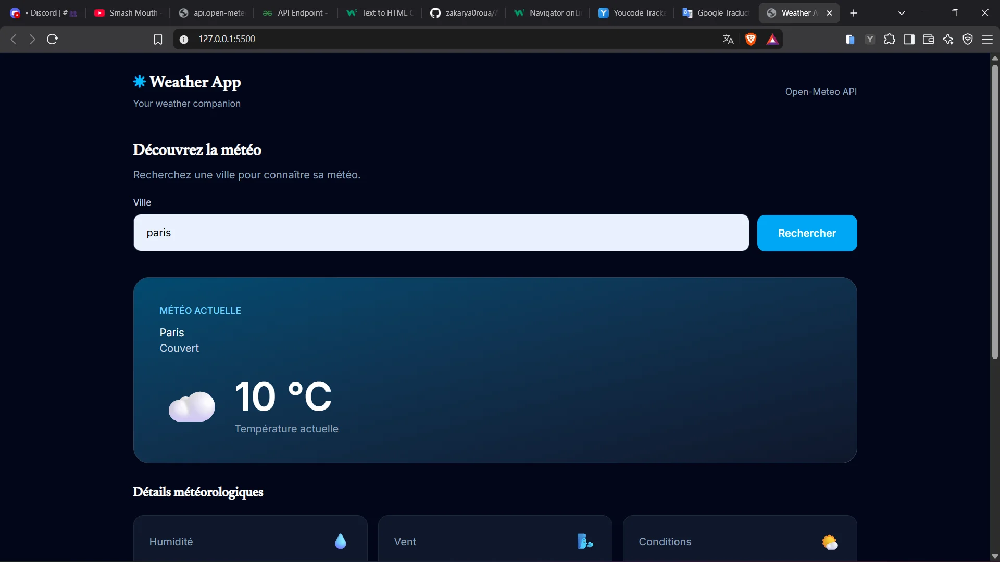
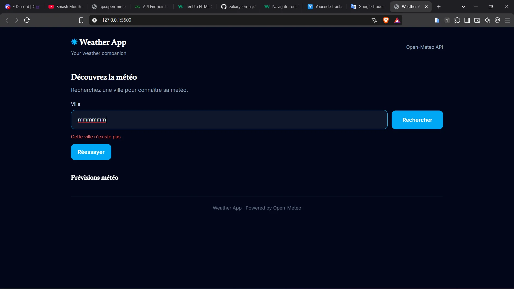

# 🌤️ Weather App

Application web permettant de rechercher une ville et de consulter sa
météo actuelle ainsi que les prévisions des cinq prochains jours.

Les données sont fournies par l'API publique **Open-Meteo**.

## 1. Fonctionnalités

-   Recherche d'une ville.
-   Affichage de la température actuelle.
-   Affichage de l'humidité relative et de la vitesse du vent.
-   Affichage des conditions météorologiques avec une icône.
-   Prévisions météorologiques sur cinq jours.
-   Messages d'erreur et bouton pour relancer la dernière recherche.

## 2. Technologies utilisées

-   **HTML5** : structure de la page.
-   **Tailwind CSS** : mise en forme (chargé actuellement avec le script
    Browser CDN dans `index.html`).
-   **JavaScript natif** : appels API et manipulation du DOM.
-   **Open-Meteo** : géocodage et données météorologiques.
-   **Google Fonts** : Inter et Newsreader.

## 3. Structure du projet

``` text
Application-meteo-multi-villes/
├── index.html
├── src/
│   ├── script.js
│   └── weatherCodes.js
├── screenshots/
│   ├── resultat-paris.webp
│   ├── previsions.webp
│   └── erreur-ville.webp
└── README.md
```

## 4. Installation et lancement

### Prérequis

-   Un navigateur web récent.
-   Visual Studio Code (recommandé).
-   Live Server ou un autre serveur HTTP local.

### Étapes

1.  Cloner le dépôt :

    ``` bash
    git clone https://github.com/zakarya0roua/Application-meteo-multi-villes.git
    ```

2.  Ouvrir le dossier du projet :

    ``` bash
    cd Application-meteo-multi-villes
    ```

3.  Ouvrir `index.html` avec Live Server.

4.  Saisir le nom d'une ville puis cliquer sur **Rechercher**.

> Le projet utilise un module JavaScript (`type="module"`). Il faut donc
> lancer la page depuis un serveur HTTP local, et non directement avec
> `file://`.

## 5. Endpoints API utilisés

L'application utilise deux endpoints Open-Meteo.

### 5.1 Geocoding API

**URL :**

``` text
https://geocoding-api.open-meteo.com/v1/search?name=${encodeURIComponent(cityInput.value.trim())}&count=10&language=en&format=json
```

**Rôle :** rechercher une ville et récupérer son nom ainsi que ses
coordonnées géographiques.

  Paramètre    Utilisation
  ------------ --------------------------------------------
  `name`       Nom de la ville saisi par l'utilisateur
  `count`      Nombre maximal de résultats demandé : `10`
  `language`   Langue des résultats : `en`
  `format`     Format de réponse : `json`

Le nom de la ville est nettoyé avec `trim()` et encodé avec
`encodeURIComponent()` avant l'envoi.

### 5.2 Forecast API

**URL :**

``` text
https://api.open-meteo.com/v1/forecast?latitude=${data1.results[0].latitude}&longitude=${data1.results[0].longitude}&current=temperature_2m,relative_humidity_2m,wind_speed_10m,weather_code&daily=temperature_2m_max,temperature_2m_min,weather_code&forecast_days=5&timezone=auto
```

**Rôle :** récupérer les conditions actuelles et les prévisions
quotidiennes à partir de la latitude et de la longitude obtenues avec
Geocoding.

  -----------------------------------------------------------------------
  Paramètre                           Utilisation
  ----------------------------------- -----------------------------------
  `latitude`                          Latitude de la ville recherchée

  `longitude`                         Longitude de la ville recherchée

  `current`                           `temperature_2m`,
                                      `relative_humidity_2m`,
                                      `wind_speed_10m`, `weather_code`

  `daily`                             `temperature_2m_max`,
                                      `temperature_2m_min`,
                                      `weather_code`

  `forecast_days`                     Nombre de jours demandés : `5`

  `timezone`                          `auto` pour utiliser le fuseau
                                      horaire de la ville
  -----------------------------------------------------------------------
## 6. Limites de l'API et bonnes pratiques

Open-Meteo propose une API publique sans clé pour l'utilisation gratuite
non commerciale, selon ses conditions d'utilisation. Les quotas et
conditions peuvent évoluer : consulter la documentation officielle avant
tout déploiement ou usage intensif.

Dans ce projet :

-   Les requêtes sont déclenchées par une recherche de l'utilisateur.
-   Seules les variables nécessaires à l'interface sont demandées.
-   Aucun appel périodique automatique n'est lancé.
-   Les erreurs HTTP sont contrôlées avec `response.ok`.

### Gestion des erreurs

  -----------------------------------------------------------------------
  Situation                           Comportement prévu dans
                                      l'application
  ----------------------------------- -----------------------------------
  Champ vide                          Afficher « Veuillez saisir une
                                      ville »

  Aucun résultat                      Afficher « Cette ville n'existe pas
                                      »

  HTTP 429                            Afficher un message indiquant que
                                      le quota est atteint

  HTTP 500                            Afficher un message d'erreur
                                      serveur

  HTTP 503                            Afficher un message de service
                                      indisponible

  Hors connexion                      Afficher « Vérifiez votre connexion
                                      Internet »

  Autre erreur                        Afficher un message d'erreur avec
                                      le statut HTTP si disponible
  -----------------------------------------------------------------------

Le bouton **Réessayer** relance la dernière recherche enregistrée.

## 7. Exemple de réponse JSON et affichage

Les exemples ci-dessous sont simplifiés pour illustrer les champs
utilisés par l'application. Les valeurs sont des exemples, pas des
données météo garanties.

### 7.1 Geocoding

``` json
{
  "results": [
    {
      "name": "Nador",
      "latitude": 35.1681,
      "longitude": -2.9335,
      "country": "Morocco"
    }
  ]
}
```

-   `name` : nom affiché dans la carte météo.
-   `latitude` et `longitude` : coordonnées utilisées pour construire la
    requête Forecast.

### 7.2 Forecast

``` json
{
  "current": {
    "temperature_2m": 22.5,
    "relative_humidity_2m": 65,
    "wind_speed_10m": 12.4,
    "weather_code": 1
  },
  "daily": {
    "time": ["2026-11-12"],
    "temperature_2m_max": [25.0],
    "temperature_2m_min": [16.0],
    "weather_code": [1]
  }
}
```

  Champ JSON                       Affichage dans l'application
  -------------------------------- --------------------------------------
  `current.temperature_2m`         Température actuelle en °C
  `current.relative_humidity_2m`   Humidité relative en %
  `current.wind_speed_10m`         Vitesse du vent en km/h
  `current.weather_code`           Code météo et description associée
  `daily.time`                     Date de la prévision
  `daily.temperature_2m_max`       Température maximale en °C
  `daily.temperature_2m_min`       Température minimale en °C
  `daily.weather_code`             Icône et description de la prévision

Le fichier `src/weatherCodes.js` associe les codes météo à un libellé et
à une icône. Si un code n'est pas reconnu, l'application utilise un
libellé et une icône par défaut.

## 8. Captures d'écran

### Météo actuelle



### Détails météorologiques et prévisions


### Recherche d'une ville inexistante

Lorsqu'un utilisateur recherche une ville
inexistante, l'application affiche un message
d'erreur : « Cette ville n'existe pas ».



## 9. Journal des tests manuels

Les tests suivants permettent de vérifier le bon fonctionnement de l'application Weather App.

| Test                          | Résultat attendu                                       | État                            |
| ----------------------------- | ------------------------------------------------------ | ------------------------------- |
| Rechercher Paris              | Afficher la météo actuelle et les prévisions           | Vérifié visuellement            |
| Rechercher une autre ville    | Afficher les données de la ville recherchée            | Vérifié                         |
| Champ de recherche vide       | Afficher « Veuillez saisir une ville »                 | Vérifié                         |
| Ville inexistante             | Afficher « Cette ville n'existe pas »                  | Vérifié visuellement            |
| Connexion Internet désactivée | Afficher « Vérifiez votre connexion Internet »         | Vérifié                         |
| Bouton Réessayer              | Relancer la dernière recherche                         | Vérifié                         |
| Erreur HTTP 429               | Afficher un message indiquant que le quota est atteint | Implémenté, simulation à tester |
| Erreur HTTP 500               | Afficher un message d'erreur serveur                   | Implémenté, simulation à tester |
| Erreur HTTP 503               | Afficher un message de service indisponible            | Implémenté, simulation à tester |

### Résultats et observations

- La recherche de Paris et l'affichage des données météorologiques ont été vérifiés visuellement.
- La gestion des erreurs 429, 500 et 503 est présente dans le code.
- Les autres scénarios doivent être testés manuellement pour confirmer leur fonctionnement.

### Remarque technique

Lorsqu'un utilisateur soumet le formulaire vide après une erreur précédente, le bouton « Réessayer » doit être masqué afin d'éviter de relancer une recherche sans ville.

**Comportement attendu :** afficher le message «  Veuillez saisir une ville » et masquer le bouton « Réessayer ».

## 10. Sécurité et clé API

-   Open-Meteo ne nécessite pas de clé API pour les requêtes utilisées
    dans ce projet.
-   Aucune clé secrète n'est donc stockée dans le code.
-   Aucune clé API n'est nécessaire dans un fichier `config.js`.

Vérifier également le dépôt Git avant publication pour s'assurer
qu'aucun secret personnel n'a été ajouté par erreur.

## 11. Sources et attribution

-   Open-Meteo : https://open-meteo.com/
-   Documentation Geocoding API :
    https://open-meteo.com/en/docs/geocoding-api
-   Documentation Forecast API : https://open-meteo.com/en/docs

Données météorologiques fournies par **Open-Meteo**.
